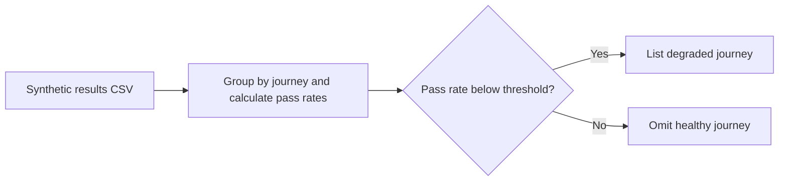

# Synthetic Check Healthboard architecture

Summarizes synthetic check pass rates and highlights degraded journeys.

## Operational boundaries

The documented run evaluates the bundled sample locally. Results depend on the quality and scope of the input. The demo makes no live infrastructure changes.
